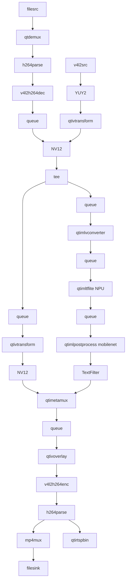

# Image Classification with QIM SDK

A sample application using QIMSDK Python app builder for image classification
via TFLite Runtime. It combines hardware-accelerated video decoding and encoding,
GPU preprocessing, and AI inference on the NPU with native
`qtimlpostprocess module=mobilenet`. File or USB camera input can be saved as
annotated MP4 or served over RTSP with browser preview.

## Requirements

- ARM64 Ubuntu 24.04; Arduino VENTUNO Q (Monza/IQ8275) is the configured CI target.
- Docker with CDI (Container Device Interface) support. Repository-packaged
  IMSDK apps run in Docker; the launcher does not support `--no-docker`.

## Setup

### Option A: Using the CLI (Recommended)

Install the CLI and fetch the app with a compatible model:

```bash
pip install qai-hub-apps
qai-hub-apps fetch image_classification_qimsdk_mobilenet_py --model efficientnet_b0 --output-dir ~
cd ~/image_classification_qimsdk_mobilenet_py
```

> [!NOTE]
> To use your own AI Hub export, pass its directory instead of a model ID:
>
> ```bash
> qai-hub-apps fetch image_classification_qimsdk_mobilenet_py --model <path/to/exported_model>
> ```

### Option B: Cloning the Repo

If you cloned the `release` branch of the [AI Hub Apps repository](https://github.com/qualcomm/ai-hub-apps/tree/release),
the app directory is already self-contained—but **model weights are not included**.
Download a compatible TFLite model (for example, EfficientNet-B0, ConvNext-Tiny,
or GPUNet) from [AI Hub Models](https://aihub.qualcomm.com/iot/models), unzip the
bundle, and copy these files into the app before running:

- `models/classifier.tflite` — the model file, renamed.
- `models/labels.txt` — the labels from the same model export.

See **Model Compatibility** below for the supported model/precision combinations.

## Build

### Install Docker

Follow the [Docker installation instructions for Ubuntu](https://docs.docker.com/engine/install/ubuntu/#install-using-the-repository).

### IMSDK device files

On first use, `./launch.sh` asks for consent and downloads the device's pinned
CDI and environment files to `/etc/cdi/qimsdk.json` and
`/etc/docker/env/qimsdk.env`. These expose the GPU, NPU, and video hardware.

## Model Compatibility

The postprocessing module is fixed to `mobilenet`. No custom Python tensor
postprocessing, ONNX runtime, `mobilenet-softmax`, or local display sink is used.

| Model | Visually validated TFLite precision |
|---|---|
| EfficientNet-B0 | Float32 |
| ConvNext-Base | Float32 |
| ConvNext-Tiny | Float32, W8A8 |
| EfficientNet-V2-s | Float32 |
| Beit | Float32 |
| MNASNet05 | Float32 |
| EfficientNet-B4 | Float32 |
| GPUNet | Float32, W8A8 |
| Sequencer2D | Float32, W8A8 |
| LeViT | Float32 |
| Mobile-VIT | Float32 |

## Run

`./launch.sh` builds the Docker image, installs dependencies inside the
container, then runs the app. App arguments go after `--`. The CLI supplies
device identity; when launching manually, set:

```bash
export QAI_HUB_APPS_DEVICE_NAME="Arduino VENTUNO Q"
export QAI_HUB_APPS_DEVICE_OS="Ubuntu 24.04"
```

Start with `./launch.sh --test`, then use the following examples.

### Steps to Run

For a fetched app bundle, run its generated launcher on the supported device:

```bash
# Default: USB -> classification -> RTSP/browser preview
./launch.sh

# File -> classification -> MP4
./launch.sh -- --input-type file -i ./classification_sample.mp4 \
  --output file --output-file ./output.mp4

# File -> classification -> RTSP/browser preview
./launch.sh -- --input-type file -i ./classification_sample.mp4 --output rtsp
```

For troubleshooting, enable verbose SDK logs:

```bash
./launch.sh -- --log-level debug
```

The default `info` level avoids Debug performance output during normal demos.
This controls IMSDK logging, not independently configured GStreamer/QNN logging.

View RTSP at `rtsp://<device-ip>:8900/live`, or browser preview at
`http://<device-ip>:8080`. USB cameras must support the documented YUY2 path and
be exposed to the container. The launcher handles platform-specific CDI/env
assets; consult the Qualcomm container documentation for device prerequisites.

## Configurable Options

| Option | Default | Description |
|---|---|---|
| `-m`, `--model-base-path` | `./models` | Directory containing classifier.tflite and labels.txt |
| `--input-type` | `file` | file or usb-camera |
| `-i`, `--input-config` | File: ./classification_sample.mp4; USB: detected device | H.264 MP4 or USB V4L2 node |
| `--output` | `file` | file or rtsp |
| `--output-file` | `./output.mp4` | Annotated MP4 path |
| `--rtsp-port` | `8900` | RTSP server port |
| `--rtsp-mount` | `/live` | RTSP mount point |
| `--log-level` | `info` | IMSDK verbosity: error, warning, info, or debug |
| `--log-classifications` | Disabled | Print the native module's emitted labels and confidences |

The launcher/run script defaults to USB input and RTSP output; arguments passed
to the app override these defaults. The generated launcher exposes ports 8080
and 8900. Using a different RTSP port requires matching container port mapping.

## Pipeline Flow

### Text Summary

File input uses filesrc, qtdemux, h264parse, hardware H.264 decode, a decoder
queue, and NV12 normalization. USB input uses v4l2src, YUY2 caps, qtivtransform,
and NV12 caps. A tee splits video from preprocessing/inference/classification.

The AI branch runs qtimlvconverter, TFLite with the QNN HTP external delegate,
and native mobilenet postprocessing. TextFilter carries classification metadata
into qtimetamux. The video branch includes a private NV12 buffer copy before
metadata attachment. qtivoverlay draws the labels; H.264 hardware encoding feeds
either mp4mux/filesink or qtirtspbin. RTSP uses config-interval=1 and mode=sync.

### Mermaid Diagram



## Tests and shutdown

```bash
./launch.sh --test
```

The test uses `assets/classification_sample_video.mp4`, enables
`--log-classifications`, and checks the captured prediction lines for computer/display
(`monitor`, `screen`, or `desktop.computer`), mouse (`mouse`), and cup/mug
(`cup` or `coffee.mug`) labels somewhere in the video. It also rejects missing/empty
output and checks MP4 readability with gst-discoverer-1.0. Logging is disabled
for normal runs and does not change native result count or thresholds.

Set QAI_HUB_APPS_TEST_VIDEO only for an input containing the same expected objects;
the fixture's label assertions still apply. Visual review remains complementary
to this label-presence check.

Ctrl+C requests graceful stop/EOS. The app waits for output finalization and
propagates worker errors. A hung plugin can delay shutdown; SIGKILL or power loss
cannot guarantee a playable file. A finite file RTSP source stops at natural EOS;
USB capture continues until stopped. Only one output is selected per run.
