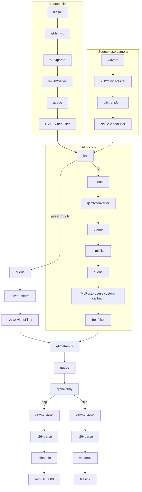

# Object Detection in IMSDK

A configurable version of the QIMSDK reference object-detection app that
uses a **custom Python postprocess callback** (manual tensor decode + NMS +
detection population) instead of the built-in `qtimlpostprocess` module.

Input source and output sink are selectable at runtime; inference runs on the NPU.

## Requirements

- ARM64 Ubuntu 24.04 (tested on the Arduino VENTUNO Q)
- Docker with CDI (Container Device Interface) support. IMSDK apps run only in
  Docker; there is no native (`--no-docker`) mode.

## Setup

### Option A: Using the CLI (Recommended)

Install the CLI and fetch the app with the model:

```bash
pip install qai-hub-apps
qai-hub-apps fetch object_detection_imsdk_py --model yolox --output-dir ~
cd ~/object_detection_imsdk_py
```

> [!NOTE]
> To use a model you exported yourself with [AI Hub Models](https://github.com/qualcomm/ai-hub-models),
> pass the exported model path to `--model` in place of a model ID. The CLI places the exported
> assets into the app automatically:
>
> ```bash
> qai-hub-apps fetch object_detection_imsdk_py --model <path/to/exported_model>
> ```

### Option B: Cloning the Repo

If you cloned the release branch, the app directory is already self-contained — but **model weights are not included**. Download a compatible model (YOLOX, YOLOv8 Detection or YOLO26 Detection) from [AI Hub Models](https://aihub.qualcomm.com/iot/models), unzip the bundle and copy these files into the app before running:
- `models/detector.tflite` (the model file, renamed)
- `models/labels.txt`

## Build

### Install Docker

Follow [these instructions](https://docs.docker.com/engine/install/ubuntu/#install-using-the-repository) to install Docker.

### IMSDK device files

On first use, `./launch.sh` asks for consent, then downloads the device's
pinned IMSDK CDI and env files to `/etc/cdi/qimsdk.json` and
`/etc/docker/env/qimsdk.env`. These give the container access to the GPU,
NPU and video hardware.

## Run

`./launch.sh` builds the app's Docker image on first use, installs the app's
dependencies inside the container, then runs the app. App arguments go after `--`.

The device files are chosen by device name and OS, so set them first (the
`qai-hub-apps` CLI sets these for you):

```bash
export QAI_HUB_APPS_DEVICE_NAME="Arduino VENTUNO Q"
export QAI_HUB_APPS_DEVICE_OS="Ubuntu 24.04"
```

Start with the app's self-test:

```bash
./launch.sh --test
```

`test.sh` downloads a test video, runs detection on it, and saves an annotated MP4.

### Run with a USB camera

```bash
./launch.sh
```

This captures from the host's first USB camera, runs detection, and serves the
annotated stream two ways:

- in a browser at `http://<device-ip>:8080` (the web UI);
- over RTSP at `rtsp://<device-ip>:8900/live`, e.g. for VLC.

To pick a camera, pass its device node: `./launch.sh -- -i /dev/video2`.

### Run on a video file

```bash
./launch.sh -- --input-type file -i <path/to/video.mp4> --output file --output-file <path/to/output.mp4>
```

Paths are inside the container, where the app directory is mounted at `/app`, so
keep input and output files in the app directory.

## Files

- `main.py` — the detection app: pipeline, custom postprocess callback, and CLI
- `launch.sh` — builds the app's container and runs `run.sh` or `test.sh` in it
- `run.sh` — USB camera input, RTSP output, web UI
- `test.sh` — self-test on a downloaded video, writing an annotated MP4
- `install_runtime.sh`, `requirements.txt` — Python dependencies installed into
  a venv in the container
- `models/` — `detector.tflite` and `labels.txt` (fetched, not committed)

## Configurable Options

| Option | Values | Default | Meaning |
|---|---|---|---|
| `-m` / `--model-base-path` | path | `./models` | Directory holding `detector.tflite` and `labels.txt` |
| `-i` / `--input-config` | path or device node | `./ai_demo_sample.mp4` for `file`; the host's first camera for `usb-camera` | File path (for `file`) or V4L2 device node like `/dev/video2` (for `usb-camera`) |
| `--input-type` | `file`, `usb-camera` | `file` | Input source |
| `--output` | `rtsp`, `file` | `rtsp` | Output sink (`rtsp` is also shown in the web UI on port 8080) |
| `--output-file` | path | `./output.mp4` | Output MP4 (only used with `--output file`) |
| `--rtsp-port` | port | `8900` | RTSP server port (only used with `--output rtsp`) |
| `--rtsp-mount` | path | `/live` | RTSP mount point (only used with `--output rtsp`) |

`main.py` itself defaults to `--input-type file --output rtsp`; `run.sh` passes
`--input-type usb-camera --output rtsp`, and `test.sh` passes a test video with
`--output file`.

Inference runs on the NPU: `qtimltflite` with `delegate=external`,
`external-delegate-path=libQnnTFLiteDelegate.so` and
`external-delegate-options="QNNExternalDelegate,backend_type=htp,log_level=(string)1;"`.
There is no CPU or GPU option.

With `--input-type usb-camera` and no `-i`, the app captures from the host's
lowest-numbered V4L2 node that can capture video. The chosen input is printed at
startup as `[info] input (...)`.

## Assumptions

- The model and labels live in `--model-base-path` (default `./models`):
  `detector.tflite` and `labels.txt`, one class name per line where the line
  index is the class id. `qai-hub-apps fetch` places both there.
- The postprocess callback assumes the model emits **3 output tensors** in the
  order bboxes, scores, class ids, which the quantized AI Hub exports of YOLOX,
  YOLOv8 Detection and YOLO26 Detection provide. Any other count is an error.
- Detection settings: score threshold `0.70`, IoU threshold `0.50`, and every
  class drawn in green (labels files carry no colors).
- The `file` input assumes H.264 in MP4 (`qtdemux` + `h264parse` + `v4l2h264dec`
  hardware decode).
- USB camera capture is pinned to `YUY2` and converted to `NV12` by
  `qtivtransform`, which needs frames the driver can export as DMA-BUF. Real UVC
  cameras and the `vivid` test driver work; `v4l2loopback` does not.
- The custom postprocess callback needs `GstQtiML-1.0.typelib`, which the
  `qimsdk-python` image provides.

## Custom Postprocess

The postprocess callback (`make_detection_callback` in `main.py`) replaces the
built-in `qtimlpostprocess` decode:

1. reads the input region and tensor size from `mlparams` (`get_input_region`);
2. reads the 3 output tensors as float32 (`get_output_tensors`);
3. maps boxes from model pixels to 0-1 coordinates of the frame region
   (`map_boxes_to_region`);
4. drops boxes below the score threshold or outside the frame (`filter_boxes`);
5. runs class-aware NMS (`batched_nms`);
6. appends a `GstQtiML.Detection` per kept box, with its label name and color.

If your model's outputs differ in count or order, update steps 2–3.

At the end of a run the app prints `Number of frames`, `Frames with objects`
and `Number of objects`; `test.sh` fails if no objects were detected.

## Graceful Shutdown (Ctrl+C)

`pipeline.execute()` blocks in a GLib main loop, so `execute_pipeline` runs it on
a worker thread while the main thread waits in short, interruptible joins. On
Ctrl+C it calls `pipeline.stop()`, which sends EOS downstream. With `--output
file` the pipeline is set to send EOS on stop, so the muxer writes the MP4 index
and **the recorded file stays playable** instead of being left corrupt. A file
input that reaches its end finalizes the same way without Ctrl+C.

`launch.sh` runs the app with `docker exec -it` when stdin is a terminal, so
Ctrl+C reaches the app inside the container. Over SSH, use `ssh -t` so there is a
terminal; without one, let a file-input run finish on its own.

## Pipeline Flow

### Text Summary

A single source is converted to `NV12` and split with a `tee`:

- **Source (file):** `filesrc → qtdemux → h264parse → v4l2h264dec → queue →
  NV12 VideoFilter → tee`.
- **Source (usb-camera):** `v4l2src → YUY2 VideoFilter → qtivtransform →
  NV12 VideoFilter → tee`.
- **AI branch:** `tee → queue → qtimlvconverter → queue → qtimltflite → queue →
  MLPostprocess(custom callback) → TextFilter → qtimetamux`.
- **Passthrough branch:** `tee → queue → qtivtransform → NV12 VideoFilter
  → qtimetamux` (forces a writable copy so metadata attaches while the encoder
  holds buffers).
- **Merge + overlay:** `qtimetamux → queue → qtivoverlay`.
- **Output (rtsp):** `qtivoverlay → v4l2h264enc → h264parse (config-interval=1)
  → qtirtspbin`. The web UI reads this stream and shows it on port 8080.
- **Output (file):** `qtivoverlay → v4l2h264enc → h264parse → mp4mux → filesink`
  (with `pipeline.eos(True)` to finalize the MP4).

### Mermaid Diagram



## Container Details

`./launch.sh` runs the app in a container built on the Qualcomm `qimsdk-python`
image (see <https://imsdkdocs.qualcomm.com/advanced/docker>). It reuses the same
container across runs and stops it when the app exits.

- **App files:** the app directory is bind-mounted at `/app`, so models, labels
  and media in it are visible to the container, and outputs written there appear
  on the host.
- **Accelerators (GPU / NPU / video codecs):** exposed through CDI rather than
  `--privileged`: `--device qualcomm.com/device=qimsdk` maps
  `/etc/cdi/qimsdk.json`, together with `--env-file /etc/docker/env/qimsdk.env`.
- **USB cameras:** the CDI file only covers the SoC's own devices, so
  `launch.sh` also bind-mounts `/dev` and allows the video4linux device class
  (char major 81). Cameras plugged in after the container was created are visible
  too.
- **Ports:** 8080 (web UI) and 8900 (RTSP).
- **Python dependencies:** installed into a venv at `/opt/qaiha/venv`, created
  with access to the image's system packages so `qimsdk` and PyGObject still
  import.
- **No display output:** the pinned CDI files do not mount the host's Wayland
  session, so there is no `waylandsink` output. Use `--output rtsp` (web UI) or
  `--output file`.
- **ISP camera:** not supported in the container. This app does not use it
  (`qtiqmmfsrc` / `qticamsrc`), so that does not affect it.

Pass `--clean` to `launch.sh` to remove the container and image and start fresh.
